# Change Observation Bell — design discussion

**Status:** Draft for comment

**Feature:** Alternate observation bell

---

## 1. Introduction

It is 10 years since Alex Tatlow raised the Complib feature request **[107](https://complib.org/issue/107) – Change Observation Bell**. A number of similar and related requests have been raised since, with others expressing support, including:

- **[177](https://complib.org/issue/177)** – Calling positions transposition for non-tenor ringing callers
- **[385](https://complib.org/issue/385)** – Observation Bell
- **[678](https://complib.org/issue/678)** – Entering a composition with a bell other than the tenor as the observation

One driver for presenting compositions with an observation bell other than the tenor is the encouragement of female conductors who may be more reticent to ring the tenor. However, it should be accepted that ringing a lighter bell can be an advantage for anyone wishing to develop their conducting skills. Ringing a tenor, especially a heavy one, requires concentrated effort and anticipation to ring it well, so that is an unnecessary distraction if one is trying to concentrate on conducting. Many experienced conductors prefer to ring a working bell, as being closer to the action can make it easier to spot and correct mistakes.

So the question is *"How can Complib help?"*. About 5 years ago I did some work on developing the ability to specify an alternate observation and get Complib to represent the calling with that bell as observation. It did the basics of representing a composition pretty well, but at the same time it raised a number of questions about how the feature could provide maximum benefit while being easy to understand and use.

I am circulating this document to those who have commented on any of the issues above, plus a few others who may have views on the topic. Below I provide some examples and raise some questions for you to respond to if you would like to. This which will help crystallise the working of the feature which I plan to resume work on now.

### 1.1 How to respond

Questions are numbered **Q1**–**Q13** for ease of reference. Please quote the question number in your reply. You are welcome to answer only the questions you have a view on. Comments on the assumptions (**A1**, **A2**) are equally welcome — those are the decisions most likely to have wide-reaching consequences.

Questions marked *(implementation)* are ones that arise from the working prototype rather than from the original feature requests. They are lower-level, and a "no strong view" answer is perfectly useful.

---

## 2. Alternate course layout

The basic premise is to provide a button in Complib's composition display that allows the selection of an alternate observation bell, like this:

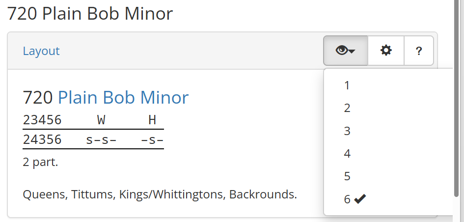

Click on **5** in the dropdown and the composition will then display like this:

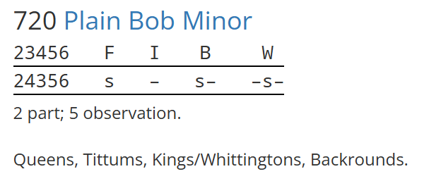

> **A1 — Assumption.** Regardless of which bell is observation, the calling position mnemonics record the position of that bell in the same way as the tenor, i.e. W is when the 5 is in 5ths place, and H would be when the 5 is in 6ths place. So *Home* is not the observation's home position unless it is the tenor.

Even with this very simple example, you can see that the conductor has to observe four calling positions instead of two, so:

> **Note.** Expressing a composition with a different observation bell does make observing the calling positions more complicated.

The same example expressed with the **2** as observation displays like this:

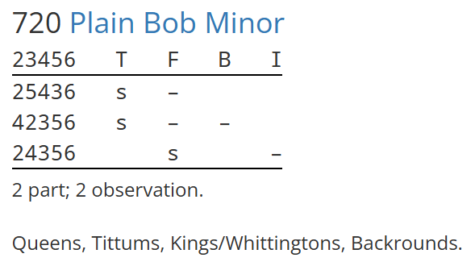

We can see that the composition, as well as using more columns, requires more rows to display.

### 2.1 Observations that do not come home at the part end

Now, what happens if we use an observation bell that does not come home at the part ends, such as the **4**?

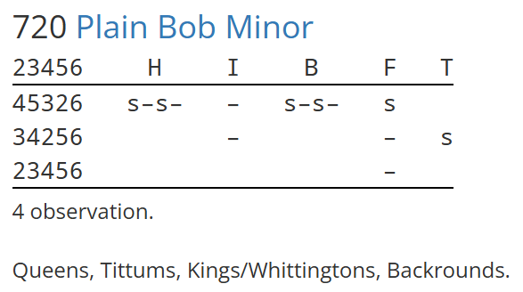

> **A2 — Assumption.** If the observation does not come back to its home position at the part ends, the composition is presented as a one-part.

Now this is an important assumption, because it means that many compositions are going to look very long and complex compared to the normal layout. Is this what we want?

An alternative is to present the first part in the same way that 7-parts are currently displayed — e.g. Smith's 23 — but then change which observation is shown in each part. However, that would mean the conductor still having to call by observing different bells in different parts.

Here is Smith's 23-Spliced as normally displayed, with the tenor as observation:

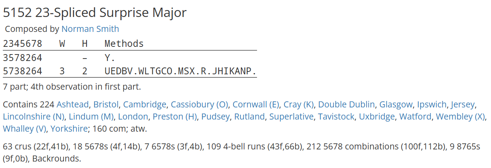

Note the existing footnote already reads *"7 part; 4th observation in first part"* — Complib derives and reports the observation bell today, and flags when it varies between parts.

This is what Smith's looks like with the **4** observation shown as a one-part:

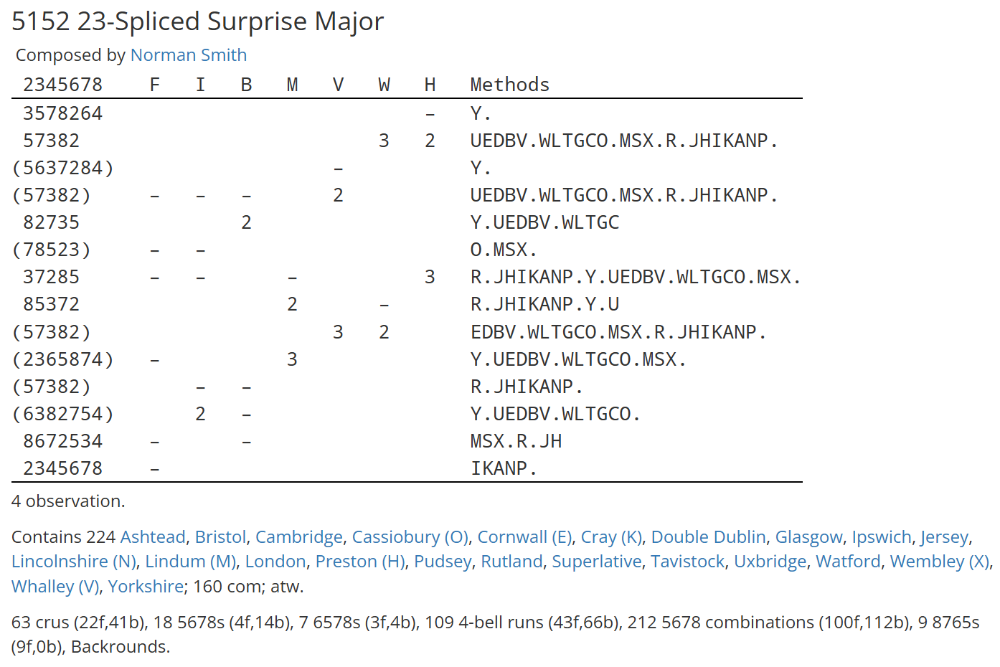

> **Q1.** Is this helpful and the best approach?

One possible improvement to the one-part presentation might be if it could draw lines between each part even though it is still displayed as a one-part.

> **Q2.** The alternative is to continue to show a single part, but change the bell used as the observation in the first part. If this is the approach, does altering the observation help in any way?

---

## 3. Alternate coursehead display

> **Q3.** Should the coursehead masks be changed — for example, to the home position of the observation?

Courseheads with the **6** home (the current default):

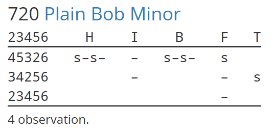

Courseheads with the **4** in 6ths (substitute home):

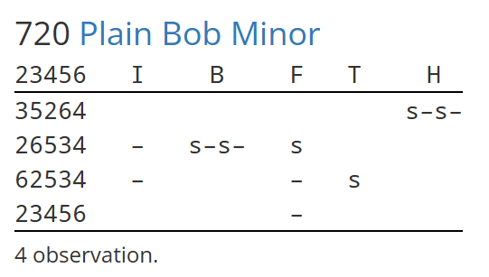

Courseheads with the **4** in 4ths (observation home):

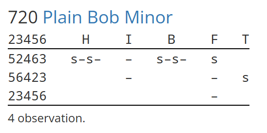

Note that this choice interacts with **A1**. If mnemonics stay tenor-relative (A1) but courseheads become observation-relative, the two halves of the display are describing the bell's position by different conventions, which may be more confusing than either option on its own.

---

## 4. Numbered calling positions

> **Q4.** It is possible to present compositions entered using numbered calling positions with named calling positions using an observation, but how useful is it?

Here is a composition of Grandsire Caters:

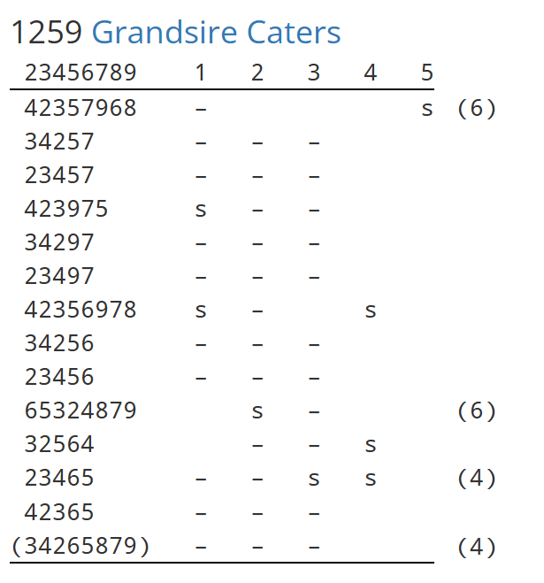

Now expressed with the **7** as observation:

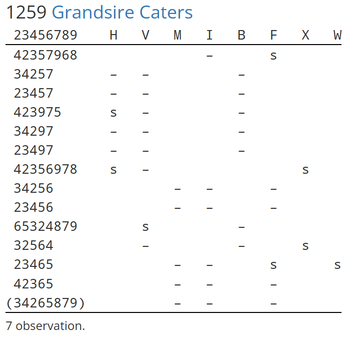

Although these calling positions are not familiar in Grandsire, more problematic is that there is nothing to tell you how many leads you are in the hunt for without inspecting the blue line. Again, it could be presented with courseheads where the observation is home, but that would lose the familiar structure.

### 4.1 Stedman and Grandsire

> Principles and methods with a hunt-bell-based calling convention are the cases where the position-name convention in **A1** fits least well, may just give a cannot layout message, and may be worth treating explicitly.

> **Q5.** Are there ways in which this feature could work or help with methods like Stedman?

---

## 5. Undisplayable observation bells

There will be situations where it is impossible to lay out a composition with a particular observation — the treble being a good example if it is a hunt bell. A message is issued in these cases:

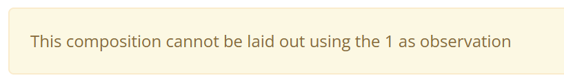

This is implemented. The re-derivation is attempted, and the request is rejected if any of the following occur:

- the re-derivation throws (for example, a composition with no calls has no calling positions to re-derive);
- the re-derived composition fails to prick;
- the re-derived composition is degraded relative to the original — it no longer comes round, becomes false, or acquires errors.

The comparison is made against the original composition's own state, so an already-false composition is not rejected merely for still being false.

On the main composition page the original observation is retained and the message shown above the layout, so the dropdown remains available to choose a different bell. On the sub-pages (print, blue line, rows, copy, edit) the same message is returned as an error.

> **Q6.** *(implementation)* Is silently falling back to the original observation, plus a warning, the right behaviour on the main page? The alternative is to show an error page.

### 5.1 Known limitation: higher stages

Calling position mnemonics are currently derived from the observation's place: L, I/B, B/T, F, V, X, S, E, N, plus M, W, H relative to the back. Above Maximus there are places in the middle of the row with no name in this scheme, and a re-derivation involving one of them cannot currently be expressed.

> **Q7.** *(implementation)* Is it acceptable for alternate observations to be unavailable for some bells above Maximus, or is a numbered fallback (as in section 4) preferable to refusing?

---

## 6. Rotating compositions

Another way of making a composition easier to call is to rotate the composition so that the tenor observation becomes a different bell, which then uses an identical calling to the tenor's original. This changes the musical characteristics of the composition and may, for example, cause the tenors to be reversed at backstroke.

> **Q8.** Is providing a generic ability to rotate compositions a useful feature, or would it be better to rely on specific rotations being selected and input as good examples (as some already have been)? If the latter, should rotation only be an option in the composition editor?

> **Q9.** If rotating compositions is a useful feature, then how should the point of rotation be selected? Should it be available only from leadheads (in which case a dropdown of available leadheads might work), or from any row? The latter would require more manipulation of the composition to split a lead into two method components.

Note that rotation and alternate observation are complementary rather than alternatives: rotation preserves the calling and changes the music, whereas alternate observation preserves the rows and changes the presentation.

---

## 7. Storing a selected observation with every composition

If every composition had a selected observation bell, with the default being the tenor, then this could have a number of benefits:

- The default calling positions can be derived using the selected observation (issue 678).
- The selected observation could be shown under the composition as a footnote, obviating the need to list the (standard) calls in the footnote.
- Observation bell could be added as a selection field in composition search (issue 385).
- The starting observation could be reliably set in the alternate observation dropdown.

> **Note.** This field would need to be derived for the 100,000 existing compositions.

> **Q10.** Is a single observation bell sufficient, and is *none* an appropriate option?

*None* could apply to compositions with only numbered calling positions. Multiple observations can be handled using explicit calling positions, but another question arises:

> **Q11.** Should multiple observations ever be shown in footnotes? Examples are compositions for differential methods where a single observation may pass the same calling position several times in a course.

### 7.1 Relationship to the current derivation

Complib already derives the observation bell on the fly, both for the *"n observation"* footnote and to decide which bell the dropdown should show as current. The derivation inspects the observation masks on the calling positions, transposing for the part head on multi-part compositions, and falls back to the tenor when no usable mask exists. Where the observation varies between parts, it resolves to the first part's bell — hence footnotes such as *"4th observation in first part"*.

A stored field would replace this derivation with a known value. The derivation would still be needed once, to populate the field for existing compositions.

> **Q12.** *(implementation)* If a stored field is added, should the derived value remain as a fallback for compositions where the stored value is absent or no longer valid (for example after the calling is edited)?

---

## 8. Implementation status

This section summarises what exists (in test) today, to set the context for the questions above. It is not itself a proposal.

**Working:**

- Re-derivation of a composition against an alternative observation bell. The calls are re-sorted by the observation's position, new calling positions and mnemonics are generated, and a new calling is built and pricked.
- Selection via the eye-icon dropdown in the Layout panel header, listing every bell from 1 to the stage, with the current observation check-marked (as shown in section 2).
- Selection via a URL query parameter, so a chosen observation is shareable and bookmarkable.
- The choice is carried through to the print, blue line, rows, copy and edit views, so those are consistent with what is on screen.
- Rejection and messaging for undisplayable observations (section 5).

**Not yet addressed — dependent on the answers below:**

- Coursehead mask handling (**Q3**).
- Part-structure presentation policy (**Q1**, **Q2**).
- A stored observation field with derived calling positions and search integration (section 7).
- Rotation (section 6).

### 8.1 Note on part structure

The re-derivation clears the explicit part heads and lets them be re-derived from the rewritten calling. The effect is that a multi-part structure survives only if the new calling genuinely recurs — which is exactly the behaviour described in **A2**, arrived at as a consequence rather than as an explicit rule. If **Q1** is answered in favour of retaining the part structure, this is the point at which that decision takes effect.

### 8.2 Open implementation questions

> **Q13.** *(implementation)* When a composition displayed with an alternate observation is copied or edited, the prototype opens the *re-derived* composition, baking in the new calling positions. Is that the expected behaviour, or should copy and edit always start from the composition as stored?

> **Q14.** *(implementation)* The dropdown is currently offered only to signed-in users, although a URL carrying an observation is honoured for anyone. Should the control be available to all visitors?

---

## Appendix A — Summary of questions

| # | Topic | Question |
|---|---|---|
| A1 | Layout | Mnemonics remain tenor-relative regardless of observation. |
| A2 | Layout | Observation not returning home at the part end ⇒ presented as a one-part. |
| Q1 | Layout | Is the one-part presentation helpful and the best approach? |
| Q2 | Layout | Or keep a single part and vary the observation per part — does that help? |
| Q3 | Courseheads | Should coursehead masks change to the observation's home? |
| Q4 | Numbered positions | How useful is naming calling positions for numbered compositions? |
| Q5 | Grandsire and Stedman | Are there ways in which this feature could work or help with methods like Stedman? |
| Q6 | Errors | Fall back with a warning, or show an error page? *(implementation)* |
| Q7 | Higher stages | Refuse, or fall back to numbered positions above Maximus? *(implementation)* |
| Q8 | Rotation | Generic rotation feature, or curated rotated compositions? |
| Q9 | Rotation | How is the rotation point selected? |
| Q10 | Stored field | Is one observation bell enough; is *none* valid? |
| Q11 | Footnotes | Should multiple observations ever appear in footnotes? |
| Q12 | Stored field | Keep derivation as a fallback for the stored field? *(implementation)* |
| Q13 | Copy/edit | Should copy/edit use the re-derived or the stored composition? *(implementation)* |
| Q14 | Access | Should the dropdown be available to anonymous visitors? *(implementation)* |

---

## Appendix B — Glossary

| Term | Meaning |
|---|---|
| **Observation bell** | The bell whose position in the row is used to name the calling positions. Conventionally the tenor. |
| **Calling position mnemonic** | The letter naming a call's position — H (Home), W (Wrong), M (Middle), B (Before), I (In), F (Fourths), V, X, S, E, N, T, L. |
| **Observation mask** | The row pattern stored against a calling position that identifies where the observation bell must be for that position to apply. |
| **Part head** | The row reached at the end of each part of a multi-part composition. |
| **Coursehead mask** | The row pattern used to decide which rows are displayed as course heads in the layout. |
| **Re-derivation** | Rebuilding a composition's calling positions and calling in terms of a different observation bell, without changing the rows rung. |
